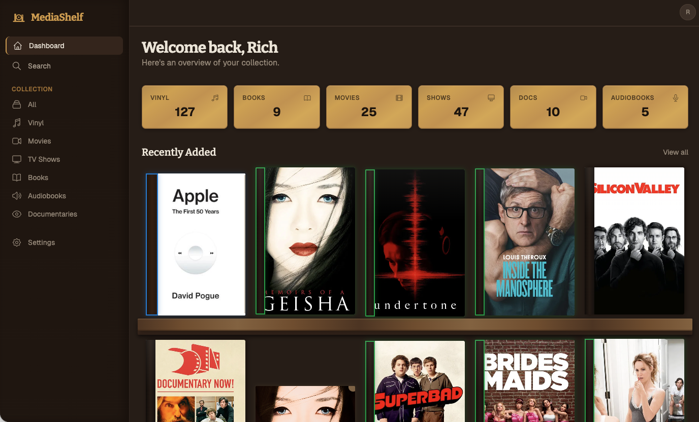
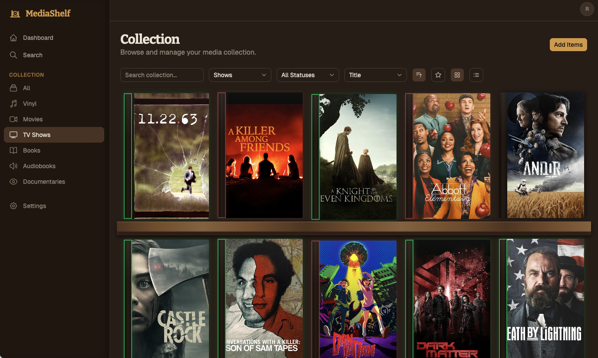
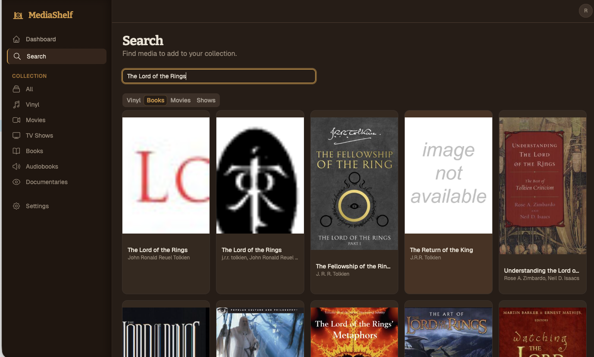
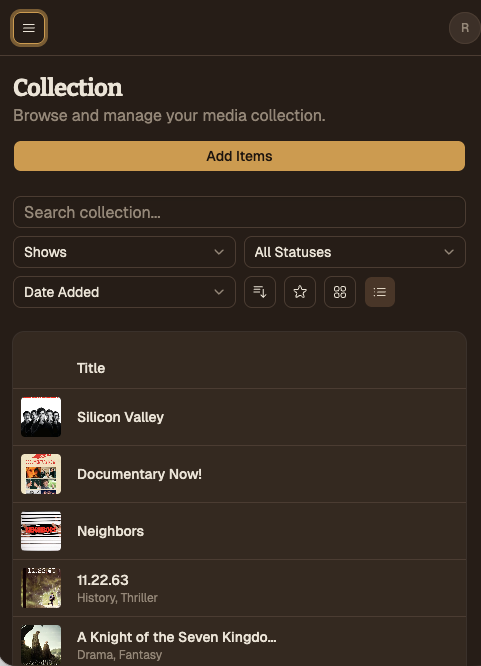

<p align="center">
  
</p>

<h1 align="center">MediaShelf</h1>

<p align="center">
  A self-hosted media cataloging app for tracking your vinyl records, books, movies, TV shows, audiobooks, documentaries, and video games.
</p>

<p align="center">
  
  
  
  
  
</p>

---

## Screenshots

<p align="center">
  
</p>
<p align="center"><em>Dashboard with collection stats and recently added shelf</em></p>

<p align="center">
  
</p>
<p align="center"><em>Collection grid view with responsive shelf layout</em></p>

<p align="center">
  
</p>
<p align="center"><em>Search and add media from Discogs, TMDB, and Google Books</em></p>

<p align="center">
  
</p>
<p align="center"><em>Mobile-responsive layout</em></p>

---

## What is MediaShelf?

MediaShelf is a lightweight, Docker-based web app designed for small households (1–2 people) to catalog their personal media collections. Search for media using real external APIs, add items to your collection, rate them, tag them, and track what you own.

### Supported Media Types

- **Vinyl Records** — powered by Discogs
- **Books** — powered by Google Books
- **Movies & Documentaries** — powered by TMDB
- **TV Shows** — powered by TMDB
- **Audiobooks** — powered by Google Books
- **Video Games** — powered by IGDB (box art) or RAWG, whichever you configure

### Key Features

- **Search & Add** — Search external APIs and add items to your collection in one click
- **Collection Management** — Filter, sort, and browse by media type, status, rating, favorites, and tags
- **Status Tracking** — Color-coded glow borders indicate item status at a glance (completed, in progress, wishlist, owned, dropped). Games get their own set: Playing, Want to Play, Beat, Dropped
- **Responsive Shelf Layout** — Items fill the shelf width naturally, scaling from 2 columns on mobile to 6 on large monitors
- **AI Recommendations** — Optional "Recommended for You" shelf built from what you rate highly and finish, using a local model (Ollama) or Claude. Mark picks as already seen or not interested and they shape the next run
- **Household Support** — Multiple user accounts with admin/member roles; view each other's collections
- **Invite-Only Sign-Up** — After the first (admin) account, new accounts need an invite code you set
- **Dark Mode First** — Clean dark UI with light mode and system theme options
- **Fully Self-Hosted** — Runs entirely on your own hardware via Docker Compose
- **Mobile Friendly** — Responsive design that works on phones, tablets, and desktops

---

## AI Recommendations (optional)

The dashboard can show a **Recommended for You** shelf. It's off until you point MediaShelf at a model.

**How picks are made**
1. Your top-rated, favorited and finished items in each media type become a taste profile.
2. Candidates come from real catalogs only:
   - TMDB's own recommendations for your favorite films and shows;
   - model suggestions for music, books and games, kept only if they match a real Discogs, Google Books, IGDB or RAWG result.
3. The model picks 10 and writes a one-line reason that names something in your library.

The model can only choose from that list, so it can't recommend things that don't exist.

**Using it**
- Click a pick to see its description, the reason it was picked, and an **Add** button.
- **Already seen it** or **Not interested** hides a pick for good. Both kinds are never recommended again and go on a "don't suggest" list. "Not interested" picks are also given to the model as things to steer away from. A toast offers **Undo**.

**Refreshing**
- Picks are saved and rebuilt about once a day (`RECOMMENDATIONS_REFRESH_HOURS`).
- The app checks hourly. If the model's machine is asleep, it keeps the last picks and tries again later.
- **Refresh** on the dashboard rebuilds on demand. A run takes roughly 30–60 seconds on a local model.

### Option A: Ollama (free, runs on your own hardware)

A Mac with Apple Silicon works well, because native Ollama uses the GPU. `gemma3:12b` gave the most specific reasons in testing, at about 30 seconds per run.

```bash
# On the machine that will run the model
ollama pull gemma3:12b
# Enable "Expose Ollama to the network" in Ollama's settings
```

```env
OLLAMA_URL=http://<that-machine's-LAN-IP>:11434
OLLAMA_MODEL=gemma3:12b
```

> Ollama has no authentication. Keep it on your LAN and never route it through a public tunnel.

To run Ollama inside the stack instead, use `docker compose --profile local-llm up -d` and `OLLAMA_URL=http://ollama:11434`. It runs CPU-only there, so expect several minutes per run.

### Option B: Claude (Anthropic API)

```env
AI_PROVIDER=claude
ANTHROPIC_API_KEY=sk-ant-...
```

This uses Claude Opus 5.5 and costs roughly $0.05 per run.

---

## Quick Start

### Prerequisites

- [Docker](https://docs.docker.com/get-docker/) and [Docker Compose](https://docs.docker.com/compose/install/)
- (Optional) API keys for [Discogs](https://www.discogs.com/settings/developers) and [TMDB](https://www.themoviedb.org/settings/api) — the app works without them, but search won't return results for those sources

### 1. Clone the repo

```bash
git clone https://github.com/rcmarchetti3/media-shelf.git
cd media-shelf
```

### 2. Create your `.env` file

```bash
cp .env.example .env
```

Edit `.env` and set:

| Variable | Required | Description |
|----------|----------|-------------|
| `POSTGRES_PASSWORD` | Yes | Database password (change from default) |
| `SECRET_KEY` | Yes | Random string for JWT signing — generate with `openssl rand -hex 32` |
| `DISCOGS_TOKEN` | No | Discogs personal access token for vinyl search |
| `TMDB_API_KEY` | No | TMDB API key for movie/show/documentary search |
| `GOOGLE_BOOKS_API_KEY` | No | Google Books API key for book/audiobook search |
| `IGDB_CLIENT_ID` / `IGDB_CLIENT_SECRET` | No | Twitch developer app credentials for IGDB game search (preferred: real box art) |
| `RAWG_API_KEY` | No | RAWG API key for game search (used when IGDB isn't set up, or as a fallback) |
| `REGISTRATION_INVITE_CODE` | For more than one account | Code new users must enter to sign up. Empty = sign-up closed once the first account exists. Generate with `openssl rand -base64 18` |
| `OLLAMA_URL` | For AI picks | Ollama address, e.g. `http://192.168.1.20:11434`. Empty = AI recommendations off |
| `OLLAMA_MODEL` | No | Ollama model to use (default: `gemma3:12b`) |
| `AI_PROVIDER` | No | `ollama` (default) or `claude` |
| `ANTHROPIC_API_KEY` | For Claude | Anthropic API key, used when `AI_PROVIDER=claude` |
| `RECOMMENDATIONS_REFRESH_HOURS` | No | How old saved picks get before they're rebuilt (default: `24`) |
| `CORS_ORIGINS` | For remote access | Comma-separated allowed origins (e.g. `https://shelf.yourdomain.com`) |
| `WEB_PORT` | No | Port to expose the web UI (default: `8080`) |

### 3. Start the stack

```bash
docker compose up -d --build
```

### 4. Open the app

Navigate to `http://localhost:8080` (or whatever port you set).

The first user to register automatically becomes the **admin**.

---

## Architecture

```
┌─────────────┐     ┌─────────────┐     ┌─────────────┐
│   Frontend   │────▶│   Backend   │────▶│  PostgreSQL  │
│  React/Nginx │     │   FastAPI   │     │     16       │
│   port 80    │     │  port 8000  │     │  port 5432   │
└─────────────┘     └─────────────┘     └─────────────┘
                           │
                 ┌─────────┴─────────┐
                 │                   │
          ┌──────┴──────┐     ┌──────┴──────┐
          │External APIs│     │  AI model   │
          │ Discogs     │     │ (optional)  │
          │ Google Books│     │ Ollama  or  │
          │ TMDB        │     │ Claude API  │
          │ IGDB / RAWG │     └─────────────┘
          └─────────────┘
```

| Layer | Tech |
|-------|------|
| Database | PostgreSQL 16 (Alpine) |
| Backend | Python 3.12, FastAPI, SQLAlchemy 2.0 (async), Alembic |
| Frontend | React 18, TypeScript, Vite, Tailwind CSS v4, Base UI |
| Auth | JWT (access + refresh tokens), bcrypt password hashing |
| Containers | Docker Compose — 3 services (db, api, web), plus an optional `ollama` profile |

---

## Local Development

The `docker-compose.override.yml` provides hot-reload for development:

```bash
# Start with hot-reload (auto-applied)
docker compose up -d --build

# Frontend: Vite dev server on http://localhost:5173
# Backend: Uvicorn with --reload on http://localhost:8000
# API docs: http://localhost:8000/docs
```

Changes to frontend and backend code are reflected immediately without rebuilding.

### Running TypeScript checks

```bash
# Inside the web container
docker exec -it media-shelf-web-1 npx tsc -b --noEmit
```

### Database migrations

```bash
# Create a new migration
docker exec -it media-shelf-api-1 python -m alembic revision --autogenerate -m "description"

# Apply migrations
docker exec -it media-shelf-api-1 python -m alembic upgrade head
```

---

## Production Deployment

### With a reverse proxy (Cloudflare Tunnel, Nginx, Traefik, etc.)

1. Clone the repo on your server
2. Create `.env` with production values (strong passwords, real API keys, CORS origins)
3. Set `WEB_PORT` to an available port
4. Run `docker compose up -d --build`
5. Point your reverse proxy at `http://localhost:<WEB_PORT>`

The production build uses multi-stage Docker images — the frontend compiles to static files served by nginx, and the backend runs Alembic migrations automatically on startup.

### Deploy script

If you develop locally and deploy to a server on your LAN, the included `deploy.sh` script handles everything:

```bash
./deploy.sh
```

This pushes to GitHub, rsyncs files to your server, and rebuilds containers. Edit the `SERVER` and `REMOTE_DIR` variables at the top of the script to match your setup.

---

## API Documentation

When running locally, interactive API docs are available at:

- **Swagger UI**: [http://localhost:8000/docs](http://localhost:8000/docs)
- **ReDoc**: [http://localhost:8000/redoc](http://localhost:8000/redoc)

### Key endpoints

| Method | Endpoint | Description |
|--------|----------|-------------|
| `POST` | `/api/v1/auth/register` | Register a new user (`invite_code` required after the first account) |
| `POST` | `/api/v1/auth/login` | Log in and get tokens |
| `GET` | `/api/v1/collection/` | List collection items (with filters) |
| `POST` | `/api/v1/collection/` | Add item to collection |
| `PATCH` | `/api/v1/collection/{id}` | Update item (rating, status, tags, etc.) |
| `GET` | `/api/v1/search/{type}?q=` | Search external APIs |
| `GET` | `/api/v1/collection/stats` | Collection stats by media type |
| `GET` | `/api/v1/recommendations/` | Saved AI picks (minus owned and waved-off items) |
| `POST` | `/api/v1/recommendations/refresh` | Rebuild picks in the background; poll `GET` until `refreshing` is false |
| `POST` | `/api/v1/recommendations/feedback` | Mark a pick `seen` or `not_interested` (`DELETE` with the same IDs to undo) |

---

## Project Structure

```
media-shelf/
├── backend/
│   ├── app/
│   │   ├── api/v1/          # Route handlers (auth, collection, search, users)
│   │   ├── models/          # SQLAlchemy models
│   │   ├── schemas/         # Pydantic request/response schemas
│   │   ├── services/        # External API clients (Discogs, TMDB, Google Books, IGDB, RAWG)
│   │   ├── config.py        # Environment config
│   │   ├── database.py      # Async DB engine & session
│   │   ├── dependencies.py  # Auth dependencies
│   │   └── main.py          # FastAPI app entry point
│   ├── alembic/             # Database migrations
│   ├── Dockerfile           # Multi-stage (dev + production)
│   └── requirements.txt
├── frontend/
│   ├── src/
│   │   ├── components/      # UI components (layout, shared)
│   │   ├── pages/           # Route pages
│   │   ├── lib/             # API client, auth context, types
│   │   └── hooks/           # Custom React hooks
│   ├── Dockerfile           # Multi-stage (dev + nginx production)
│   └── nginx.conf           # Production reverse proxy config
├── docker-compose.yml           # Production stack
├── docker-compose.override.yml  # Dev hot-reload overrides
├── deploy.sh                    # One-command deploy script
└── .env.example                 # Environment template
```

---

## Getting API Keys

### Discogs (Vinyl Records)

1. Go to [Discogs Developer Settings](https://www.discogs.com/settings/developers)
2. Click **Generate new token**
3. Copy the token to `DISCOGS_TOKEN` in your `.env`

### TMDB (Movies, TV Shows, Documentaries)

1. Create an account at [TMDB](https://www.themoviedb.org/)
2. Go to [API Settings](https://www.themoviedb.org/settings/api)
3. Request an API key (choose "Developer" for personal use)
4. Copy the API key (v3 auth) to `TMDB_API_KEY` in your `.env`

### Google Books (Books, Audiobooks)

No API key needed — the Google Books API is free for basic usage.

### IGDB (Video Games, preferred)

1. Sign in at the [Twitch Developer Console](https://dev.twitch.tv/console/apps) (enable two-factor auth on your Twitch account first)
2. **Register Your Application** → any name, OAuth redirect `http://localhost`, category *Application Integration*, client type *Confidential*
3. Copy the **Client ID** and a new **Client Secret** to `IGDB_CLIENT_ID` / `IGDB_CLIENT_SECRET`

### RAWG (Video Games, fallback)

1. Create an account at [RAWG](https://rawg.io/) and request a key at [rawg.io/apidocs](https://rawg.io/apidocs)
2. Copy it to `RAWG_API_KEY`

RAWG's terms require attribution, which the app shows wherever RAWG data appears.

### Anthropic (optional, for Claude recommendations)

1. Create a key in the [Anthropic Console](https://console.anthropic.com/) and add credit
2. Set `ANTHROPIC_API_KEY` and `AI_PROVIDER=claude`

---

## License

MIT
